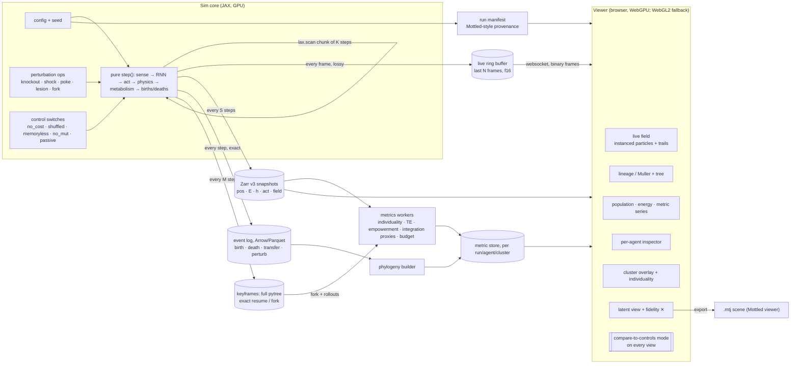

# CA adaptive-agency viz: architecture

*Draft 0 · 2026-10-08 · for Evelyn (enactedvolition)*

The goal: a research instrument for thermodynamic agent-CAs, where every dot is a tiny random RNN with an energy budget. It should look as good as Fraser Price's sims, but every picture must say what it measured, what it hides, and what the controls did. That second part is the "Mottled move" applied to artificial life.

---

## 0. TL;DR

- **Sim never draws, render never mutates.** The sim is one pure JAX step function over fixed-capacity arrays with an alive mask. It emits three streams: a live ring buffer for the screen, strided Zarr snapshots for analysis, and an exact event log (births, deaths, transfers, perturbations) for phylogeny.
- **Render layer:** a browser WebGPU viewer, with a WebGL2 fallback because that's Mottled's current viewer. It draws instanced particles from a storage buffer, puts the energy field in a texture, and keeps trails in a ping-pong feedback texture. Colour modes are genome hash, lineage, energy, dominant action, hidden-state PCs, and metric overlays.
- **Six views:** live field · lineage/Muller plus tree · population/energy series · per-agent inspector · cluster ("multicellular") overlay · latent view of hidden states with Mottled's fidelity markings.
- **Agency metrics:** Krakauer et al. 2020 individuality (A\*, A, nC) on candidate aggregates, transfer entropy, empowerment by forking the sim, integration *proxies* (never called Φ), energy-budget allocation, and perturbation recovery.
- **Honesty layer:** every metric and every view has a "vs controls" mode. Same seed, same physics, one switch per control: free energy, shuffled heredity, memoryless brains, no mutation, passive particles, and a spatial null. You don't get to say "life" or "organism" unless the effect beats every relevant control across seeds.
- **A runnable MVP already exists** in `mvp/`: JAX sim, 4 control runs, a side-by-side video and an analysis dashboard. See §9.

---

## 1. What Fraser's setup actually is

Sources: his X posts, read through the API on 2026-10-08. They are the Oct 8 post (1/2 and 2/2), the Sept 16 14-post thread, the Oct 5 and Oct 6 posts, and the July 2026 build posts. The 2/2 link `t.co/QaPJ9N3EsS` just resolves back to the Sept 16 thread; there is no blog or repo. The code is not public: "planning on open sourcing the code at some point, unfortunately its very overfit to my hardware atm" (Oct 8).

| claim | status | source (his words, paraphrased) |
|---|---|---|
| each dot is an agent with a random NN brain; no training, no backprop, no programmed survival instinct | **verified (stated)** | Sept 16 1/14, 4/14; Oct 8 |
| brain is "a random ~1k param RNN" (Oct 8); earlier "each with up to 10k params" (Jul 8); earlier still "~64 genes + random-init MLP" (Jul 1) | **verified (stated), and the design changed over time** | Oct 8 reply; Jul 8; Jul 1 |
| each agent has energy; 0 = death; existing and every action cost energy | **verified** | Sept 16 3/14; Oct 8 |
| actions: sensing, signalling, moving, bonding, splitting, applying forces, harvesting, sharing, fighting; reproduce with mutation | **verified** | Sept 16 4/14; Oct 8 |
| senses "K bg fields" and allocates energy across "A actions" per tick | **verified** | Jul 5 |
| bright patches = harvestable energy; he varies energy injection and basal cost mid-run | **verified** | Sept 16 3/14; Jul 8 |
| random spawns plus mutation, "0 external forces" | **verified** | Jul 8; Oct 8 |
| "distributed GPU-accelerated neural Cellular Automata" | **verified (his label)** | Sept 16 2/14 |
| GPU kernels written by a local LLM ("gpu kernels on my computer writing other gpu kernels for the same chip"); 100ks of particles at 1000s of steps/s | **verified (stated)** | Jul 5 |
| 500k particles and 500k NNs, realtime on 1 GPU, including rendering | **verified (stated, July build)** | Jul 8 |
| colour = the agent's genome | **verified** | Jul 8 ("genome (represented by colour)") |
| multi-GPU workstation (blower-style "max q" cards); "1–2TB VRAM" was about LLMs, not this sim | verified context, not sim-specific | Jun 30, Sept 17 |
| language/stack: CUDA vs Triton vs WebGPU vs JAX | **unknown.** "GPU kernels … for the same chip" suggests hand-written CUDA-style kernels, not JAX. **Inferred.** | — |
| neighbour search (spatial hash / cell lists) | **inferred.** You can't run 500k interacting agents in realtime without it. | — |
| trails and motion blur in the videos | **inferred** from the look. I couldn't play the videos, only thumbnails and text. | — |
| "nuclei and cell membranes" emerge | **his interpretation** (Oct 6). No metric was given. | Oct 6 |
| how he tells life from a neat viz | **not answered.** His reply to Matt Mazur's question: "imo ticks the definition boxes". | Oct 8 |

He frames it as a safety argument (Sept 16): self-replicating multi-agent systems are an overlooked x-risk. "CAs teach us: where self-replication CAN happen it WILL; it's near impossible to predict IF/WHAT; replicators adapt." That claim is exactly what an instrument with controls could test, not just illustrate.

## 2. Evelyn's existing CA / adaptive-agency material

I searched read-only on 2026-10-08:
- Notion (both connections): "cellular automata", "automata", "adaptive agency", "artificial life", "Lenia", "NCA".
- GitHub `enactedvolition`: all 9 repos plus code search for "automata" and "agency".
- The box `/workspace`.

**There is no existing CA or adaptive-agency research, code, or notes.** The Notion hits for "agency" are personal or life-admin pages, not research. The nearest relatives:
- **Portfolio: "Near-Death Experience as a Near-Criticality Phenomenon"**, a dynamical-systems experiment with ordered, near-critical and chaotic regimes classified by Lyapunov exponent (|λ|≤0.05 = near-critical). Its maximal-Lyapunov machinery transfers directly: per-agent RNN λ is a cheap brain-regime map (§5).
- **`meth-neurodiv-model`**: an ANCCR / RL-trajectory model. It's prior work on agents and trajectories, not a CA.
- **`AutoConTheo`**: a hypothesis-generation, simulation and evaluation pipeline skeleton. It could wrap this as a "Simulator & Tester".
- **Mottled**: the viz and provenance chassis to reuse (§7).
- `Neurocomp` is an empty repo.

So this doc assumes a clean start. The research question is still open, and the first decision (§10) is to state it.

---

## 3. Design principles

1. **One pure step function.** `state' = step(state, params, key)`. All state is a pytree of fixed-capacity arrays plus an `alive` mask, so a JIT doesn't recompile when the population changes. Forking, perturbing and replaying are then free: a fork is just keeping another reference to the pytree.
2. **Three output streams, never one.** The screen gets whatever's cheapest. Analysis gets strided snapshots. Phylogeny needs every birth and death, which strided snapshots drop (agents that live less than the stride vanish).
3. **Every pixel has a provenance.** Run manifest = code hash, config hash, seed, library versions, backend and device. Screenshots carry a footer with config hash, controls status and the fidelity of any projection.
4. **Every claim is paired with its control.** The viewer can always split-screen the same seed under ablations.
5. **Projections report their error.** Any 2-D view of hidden states carries per-point neighbourhood preservation, with ✕ where it fails. This is Mottled's contract, reused.

## 4. Diagram

---

## 5. Layers

### 5.1 Sim core

**State (struct-of-arrays, capacity N):**
- `pos[N,2]`, `vel[N,2]`, `E[N]`, `h[N,H]`
- `genome_id[N]` (index into a genome table), `alive[N]`
- `uid`, `parent_uid`, `root_uid`, `birth_step`
- `last_action[N,A]`, `field[G,G,K]`, `t`, `rng_key`

Genomes only change at birth, so store them once in a deduplicated table keyed by hash. Then agents carry an id, not 1–10k floats per snapshot.

**Step stages:** neighbour query → senses (field sample and gradient, neighbour count/direction/signal, kin similarity, own energy) → batched RNN (`einsum` over per-agent weights) → actions (thrust, eat, reproduce, share/attack, signal, bond …) → forces (hard-core repulsion plus bond springs) → metabolism (demand-limited harvesting per cell, transfers, per-action costs) → deaths → births into free slots (prefix-sum matching of parents to dead slots) → abiogenesis spawns → field regrowth.

**Neighbours.**
- O(N²) is fine up to a few thousand agents (the MVP uses it).
- Beyond that, use a uniform-grid cell list: sort agents by cell id, keep cell start/end offsets, and visit 3×3 cells. That's the standard GPU particle approach. It's expressible in JAX with `argsort` and `segment_sum`, but at hundreds of thousands of agents a hand-written kernel (CUDA, Triton, or a WebGPU compute shader) will beat XLA. That's presumably why Fraser has an LLM writing kernels (inferred).

**Why JAX:**
- `jit` + `vmap` + `lax.scan` turn the batched per-agent RNN and the step loop into fused GPU code.
- Explicit PRNG keys make runs reproducible from `(code, config, seed)`.
- Pure state makes empowerment rollouts and A/B forks trivial (`jax.vmap` over forks).
- Sakana's ASAL ships its ALife substrates (Lenia, Particle Life, Particle Lenia, NCA, Boids) as JAX code. That gives you comparison substrates for free.

**Alternatives considered:**
- **Taichi:** last stable release 1.7.4 (2025); now maintenance-only, and its successor fork "Quadrants" says upstream is unmaintained. Don't start there.
- **WebGPU compute in the browser:** great for a shareable demo. But on Linux it's only on by default in Chrome 144+ (Intel Gen12+) and 147+ (NVIDIA on Wayland); elsewhere it's behind flags, and Firefox on Linux is Nightly-only. That's a bad primary sim host for a Linux workstation.
- **Raw CUDA:** the fastest, and the most "overfit to my hardware". Keep it as the scale-up path once the metrics are settled.

### 5.2 Data plane

| stream | contents | format | cadence | consumer |
|---|---|---|---|---|
| live ring | pos, colour key, E, action id (f16/u8) | shared memory → websocket binary frames | every rendered frame | live view only |
| snapshots | pos, E, h (f16), act (f16), genome_id, lineage ids, field | **Zarr v3**, chunk = one snapshot `(1, N, …)` | every S steps | metrics, latent view, replay scrub |
| events | birth(child, parent, step, genome_id), death(cause), transfer(from, to, amount, kind), perturbation(op, params) | Arrow → Parquet | every step, exact | phylogeny, energy ledger, causal audit |
| keyframes | entire pytree | `np.savez` / Orbax | every M steps | exact resume, forks, empowerment rollouts |
| genome table | hash → weights | Zarr | on birth | inspector, genome-space views |

Size check at Fraser's July scale: 500k agents × 26 f16 channels (pos 2 + E 1 + h 16 + act 7) ≈ 26 MB per snapshot. With S = 100 steps, a 100k-step run is about 26 GB. That's fine on local disk, and Zarr's chunking makes "one agent over time" and "everyone at t" both cheap reads.

### 5.3 Render layer

- **Particles:** WebGPU instanced quads. Positions and attributes go in a storage buffer uploaded from the ring frame, and the vertex shader expands each one into a disc. 500k instances is light for WebGPU. Picking uses an id buffer (render agent uid to an offscreen `r32uint` target) and is O(1) per hover.
- **Field:** the K channels as an `rgba16float` texture with a colormap LUT. Default is dim, so agents stay readable.
- **Trails:** ping-pong feedback textures. Each frame draws `prev × decay`, then splats the particles, then that becomes `prev`. Decay is a slider, and it's printed in the footer because trails manufacture apparent structure (§5.8).
- **Colour modes** (one LUT/shader switch each):
  - **genome hash:** a fixed random projection of weights → RGB, continuous so kin look alike. This is Fraser's mode and the MVP's default.
  - **lineage root:** categorical hash of `root_uid`.
  - **energy:** sequential.
  - **dominant action:** categorical.
  - **hidden-state PC1–3 → RGB:** with a global PCA fitted on a reference snapshot so colours are stable over time.
  - **metric overlay:** local individuality, TE in/out, empowerment, Lyapunov regime.
- **Fallback:** WebGL2 with the same buffers as attribute arrays, matching Mottled's current viewer (`viewer/main.js` uses `getContext("webgl2")`). Mottled's `ops-webgpu.js` already does WebGPU compute for its in-browser forward pass, so there's an in-repo pattern for adapter checks and fallback.
- **Quick-start alternative** (for the inspector and time series before the custom viewer exists): Rerun (rerun.io) logs points, scalars and images on a scrubbable timeline. It's optional and not a dependency.

### 5.4 Views

1. **Live field.** Particles plus field plus trails. Overlays: cluster rings, perturbation brushes, and an energy-flow arrow field (aggregated transfer events per cell). Footer: step, population, config hash, control flags.
2. **Lineage / phylogeny.**
   - A Muller plot (stacked lineage shares over time, coloured by founder genome) above a collapsible tree built from the event log, not from snapshots.
   - Collapse rule: merge descendants whose genome distance is under ε into one clade node.
   - Click a clade to highlight its members in the live field, and its hidden states in the latent view.
3. **Population / energy / metric series.** Population, mean E, lineage count, clustered fraction, and any metric. Every series shows its control runs as faint same-colour-family lines and the seed spread as a band.
4. **Per-agent inspector** (click to pin, as in Mottled):
   - input vector over time (heatmap rows = sense channels)
   - hidden-state heatmap
   - action allocation stack
   - an energy ledger built from events (harvest, received, stolen, spent per action)
   - the lineage path to its root
   - its RNN's max Lyapunov exponent (from the NDE-criticality code)
   - a follow-cam
5. **Cluster ("multicellular") overlay.**
   - Clusters are connected components of the bond graph, or the proximity graph if bonds aren't modelled.
   - Track them across frames by membership overlap (Jaccard plus Hungarian matching).
   - Per cluster: size, kin purity (fraction sharing a root), age, energy throughput, and the individuality scores from §5.5.
   - A cluster only earns the word "organism" in the UI if it passes the gate in §5.8.
6. **Latent view.** Hidden states of all live agents, one lineage, or one cluster, projected jointly across time so trajectories are comparable.
   - It reuses Mottled's contract: per-point k-NN neighbourhood preservation, ✕ below 0.5, variance kept printed on the panel, and a bootstrap uncertainty field on any density.
   - Agent trajectories map onto `.mtj` naturally. Mottled's "layer" axis becomes time snapshots and the "token" axis becomes the agents of a fixed set, so a cluster's life exports as a scene. That needs a small adapter, not a format change: the format doc already anticipates non-transformer producers.

### 5.5 Agency metrics

Notation: S = a candidate individual (one agent's `h`, or a cluster's pooled state), E = its local environment (field patch plus non-member neighbours).

| metric | what it asks | estimator | viz | caveat |
|---|---|---|---|---|
| **Organismal individuality A\* = I(Sₙ₊₁; Sₙ)** (Krakauer, Bertschinger, Olbrich, Flack & Ay 2020, *Theory Biosci.* 139:209) | does the aggregate carry its own past forward? | discretise or KSG k-NN MI on snapshot pairs | per-cluster badge, cluster-overlay colour | grows with system size; the paper notes these measures never decrease when you add components, so use *gain per added member* to find boundaries |
| **Colonial individuality A = I(Sₙ₊₁; Sₙ \| Eₙ)** | self-propagation beyond what the environment explains | conditional MI (IDTxl / JIDT) | same | conditioning on E needs E coarse-grained; report the binning |
| **Environmentally determined nC = I(Sₙ₊₁; Eₙ \| Sₙ)** | how much is the environment driving it? | conditional MI | stacked bar A\* / A / nC per cluster | — |
| **Boundary search** | which set of agents is the individual? | grow S greedily from a seed agent while A (or predictive gain) rises; stop at the plateau (the paper's "largest set no better at predicting its future") | outline the inferred boundary vs the proximity cluster | the disagreement between the two *is* a finding |
| **Transfer entropy** field→agent, agent→agent (within/between clusters), agent→field | sensing, coordination, niche construction | IDTxl (Python) or JIDT (Java) | directed-edge overlay; TE-in/TE-out colour mode | needs long stationary windows; agents die, so pool over lineage |
| **Empowerment** (Klyubin, Polani & Nehaniv 2005): n-step channel capacity from actions to future senses | how much does this agent *control* its future? | fork the sim from a keyframe, override the agent's actions with sampled sequences, roll out n steps, discretise outcomes, run Blahut–Arimoto | heat overlay on sampled agents; empowerment vs age/energy scatter | expensive: sample agents, not everyone. Pure-state JAX makes forks `vmap`-able |
| **Integration proxies** (time-delayed whole-minus-sum MI à la Barrett & Seth 2011; O-information, Rosas et al. 2019) across cluster members | is the cluster more than its parts informationally? | Gaussian or k-NN estimators | per-cluster sparkline | **never label it Φ**; exact IIT (PyPhi) is intractable at this size |
| **Energy-budget allocation** | where does the energy go: basal, move, eat, signal, bond, attack, reproduce? | from per-action costs × outputs; exact from the event log | stacked area per run, lineage, agent | already in the MVP dashboard |
| **Perturbation response** | does it restore itself? | after an op (§5.6): recovery time of E, membership and A\* to baseline; compare with the passive-particle control | impulse-response curves with control bands | — |
| **Heritability** | do offspring resemble parents behaviourally? | parent–offspring correlation of action profiles vs the shuffled-heredity control | scatter with null band | the core "evolution, not just physics" check |
| **Brain regime** | is the RNN ordered, critical or chaotic? | max Lyapunov exponent of each genome's RNN under its typical input (reuse the NDE-criticality code) | colour mode; lineage-level histogram over time | regime ≠ fitness, but drift toward |λ|≈0 would be interesting |

Metrics run off the live path, as workers reading Zarr snapshots, keyframes and events. They write to a metric store keyed by `(run, step, agent|cluster, metric, estimator, params)` so every number knows how it was made.

### 5.6 Perturbation tooling

A perturbation is a pure function `state → state` applied between scan chunks. It's logged as an event with its parameters and always creates a **child run** (`parent_run`, `fork_step`), so the provenance forms a tree.

- **knockout:** kill agents by brush region, lineage, cluster, or genome predicate.
- **lesion:** zero one input channel, hidden unit or action for a lineage (a causal test of what each part of the brain does).
- **energy shock:** scale or zero the field in a region, drain E by x%, or change the basal cost (Fraser does this by hand mid-run).
- **poke:** an impulse to a cluster, to measure whether it holds together.
- **transplant:** give a cluster member a foreign genome.
- **freeze evolution:** mutation σ → 0 from step t.
- **fork A/B:** branch at t, apply op to B only, and run them side by side in the viewer with a synced clock.

### 5.7 Recording, replay and provenance

**Run manifest** (`provenance.json`, modelled on Mottled's `analysis` record, `mottled-analysis/1`):
- schema
- created (UTC)
- git sha + dirty-diff hash
- code hash, config + config hash
- seed
- JAX/XLA/numpy/zarr versions
- backend + device
- dtype
- control flags
- parent run + fork step
- perturbation list

**Replay:**
- *Scrubbing* reads Zarr snapshots, which is approximate between strides.
- *Exact replay* re-simulates from the nearest keyframe with the same key.
- *Determinism caveat:* GPU scatter-adds and reductions can differ bit-for-bit between runs unless XLA's deterministic-ops mode is on (check the current flag name for your JAX version). Record which mode was used in the manifest. Don't promise bit-identical replays without it.

**Export:** MP4 (ffmpeg, from the same frames the viewer shows, footer included), `.mtj` latent scenes, and metric CSVs with the run hash in the filename.

### 5.8 Honesty layer: "is it life or a neat viz?"

Matt Mazur asked Fraser exactly this (Oct 8) and got "imo ticks the definition boxes". The instrument's job is to make that answerable.

**Controls.** Each is one switch, same seed, run alongside the main run:

| control | what it removes | what survives it is not evidence of agency |
|---|---|---|
| `no_cost` | metabolism and selection pressure | anything seen here is physics or birth placement |
| `shuffled` heredity | parent → offspring genome link (children get a random living agent's genome) | kin clustering here = placement artefact |
| `memoryless` | recurrence (h ← 0 each step) | behaviour here doesn't need memory |
| `no_mut` | variation after the founders | lineage turnover here is drift and sorting, not adaptation |
| `passive` | brains (constant outputs, same physics) | the dead-matter baseline for clustering and "membranes" |
| `spatial null` | positions shuffled at analysis time | cluster statistics vs random placement |
| `neutral model` | fitness (lineage sizes under pure drift, Moran-style) | Muller-plot sweeps that drift can produce |

**The specific trap in this kind of sim:** offspring are placed next to their parents and coloured by genome hash. So clonal blobs that look like multicellular organisms appear even with no adaptation at all. Genome colour plus birth placement plus trails is a recipe for convincing organisms. The `shuffled` and `passive` controls exist to separate "kin sit together because they were born together" from "kin sit together because sitting together pays".

**Claim gate.** The UI only uses the words *organism*, *multicellular* or *adaptation* when the metric beats every relevant control. That means the effect size and a 95% CI across ≥5 seeds, shown on the panel. Otherwise the label stays neutral ("cluster", "lineage").

**Life-criteria scorecard.** Each criterion maps to a measurement with a control:

| criterion | measurement | control |
|---|---|---|
| metabolism | positive energy throughput | `passive` |
| reproduction with heredity | heritability above `shuffled` | `shuffled` |
| variation | — | `no_mut` |
| selection | lineage sweeps beyond the neutral model | neutral model |
| individuality | A / A\* above `spatial null` and `passive` | `spatial null`, `passive` |
| adaptation | recovery after shock faster than controls | relevant controls |

The scorecard sits next to every exported video.

**Viz hygiene:**
- trail decay, colour mode and point size are printed in the footer
- projection panels show kNN preservation and low-fidelity ✕
- no smoothing is applied to series without saying so

---

## 6. Recommended stack

| layer | pick | why |
|---|---|---|
| sim | **JAX** (GPU wheels), fixed-capacity SoA pytree, `lax.scan` chunks | pure functional state → reproducible, forkable, vmappable rollouts; batched per-agent RNN is one `einsum`; ASAL substrates available in JAX |
| scale-up | custom kernels (Triton/CUDA, or WebGPU compute for a browser demo) for neighbour search + the RNN step | only once the metrics are frozen; that's where Fraser's 500k realtime comes from |
| storage | **Zarr v3** snapshots + **Arrow/Parquet** event log + keyframes | chunked "all at t" and "one over time" reads; events give an exact phylogeny |
| transport | websocket binary frames (f16/u8), with a ring buffer on the sim side | the renderer never blocks the sim |
| viewer | **browser WebGPU**, WebGL2 fallback, no build step (Mottled's convention) | the same distribution story as Mottled (GitHub Pages scenes); Linux caveat above |
| metrics | numpy/JAX + **IDTxl** or **JIDT** for TE/MI; Blahut–Arimoto for empowerment | established estimators; record the estimator and parameters with every number |
| quick inspector (optional) | Rerun | timeline scrub of points + scalars on day 1 |
| video | ffmpeg from viewer frames | the footer is in the pixels |

## 7. What to reuse from Mottled (`github.com/enactedvolition/mottled`, read locally from `/workspace/mottled-repo`)

| Mottled piece | reuse as |
|---|---|
| `.mtj` container (`docs/mtj-format.md`): `MTRJ` magic + JSON manifest + 16-byte-aligned little-endian typed arrays; unknown fields ignored | the export format for latent scenes (time × agents × H) and possibly for snapshot clips. JS reader is `DataView` + typed arrays only. |
| `provenance.record` / the `analysis` schema | the run-manifest shape (§5.7) |
| `projection.neighborhood_preservation`, `LOW_FIDELITY = 0.5`, `fidelity_summary` | latent view fidelity (the MVP mirrors it in numpy) |
| `density.py` bootstrap SE field | uncertainty overlay on agent-density and hidden-state density maps |
| `viewer/` (WebGL2, no deps, no build, `?file=` loading, hover inspector + click to pin, `bvh.js` picking) | viewer conventions and inspector UX; BVH picking for trajectory hover in the latent view |
| `viewer/ops-webgpu.js` | in-repo WebGPU compute pattern (adapter checks, fallback) |
| `tests/test_reading_conformance.py` idea: one computation, two surfaces | metric numbers must match between Python analysis and the viewer panel |
| `docs/validity.md` inferential contract | write a `validity.md` for CA claims: what a cluster badge does and doesn't license |

## 8. MVP slice (about a week, one person)

- **Day 1.** Done today in `mvp/sim.py`. Pure JAX step, 1.5k agents, O(N²) neighbours, a 551-param Elman RNN per agent, energy field, births into free slots, spawns, 4 controls. Zarr snapshots and a provenance manifest.
- **Day 2.** Add the event log (Parquet) and keyframes. Build the phylogeny from events; add the Muller plot plus a collapsible tree (static HTML/Canvas).
- **Day 3.** Minimal browser viewer. Load a snapshot clip (`.mtj`-style container) and draw instanced particles in WebGL2 (WebGPU path behind a check), with feedback-texture trails, genome/lineage/energy/action colour modes, and click-to-pin inspector showing the inputs, h and actions series.
- **Day 4.** Cluster tracking (bond/proximity graph, overlap matching), kin purity, cluster overlay; A\* and A per cluster with a binned estimator; spatial-null and passive controls.
- **Day 5.** Perturbation ops (knockout, energy shock, poke) as fork-from-keyframe with A/B side-by-side; impulse-response panel.
- **Day 6.** Latent view: joint PCA across time, kNN preservation ✕, `.mtj` export of one cluster's life, opened in the Mottled viewer.
- **Day 7.** Claim gate and scorecard over 5 seeds; footer on every export; `validity.md`.

**Deferred:** cell-list neighbours, 100k+ agents, empowerment rollouts at scale, TE via IDTxl, live websocket streaming. The MVP renders from snapshots.

## 9. What exists now (`/workspace/ca-agency-viz/mvp/`)

- `sim.py`: the JAX sim. Agents: 10 senses → 16-unit Elman RNN → 7 actions (thrust×2, eat, reproduce, share/attack, signal, bond). 551 params, so the same order as Fraser's "~1k". Torus world with a 96² regrowing energy field fed by 5 drifting Gaussian sources. Demand-limited harvesting, share/attack transfers, per-action costs, births into free slots with Gaussian mutation, 2 random spawns per step.
- `render.py`: reads only the Zarr + manifest. It produces the 2×2 control video with genome-hash colour, feedback trails and a population strip, plus the analysis dashboard.
- `runs/<variant>/snapshots.zarr` + `provenance.json`, `out/controls_side_by_side.mp4`, `out/agency_dashboard.png`, `out/frame_*.png`, `out/summary.json`.

**First results.** This is one seed and 4,000 steps per variant, on CPU (about 4.4 min each with all 4 running in parallel), so it's illustrative, not evidence. Values are means over the last 500 steps:

| | full | no_cost | shuffled | memoryless |
|---|---|---|---|---|
| population | 463 | 1536 (capacity) | 513 | 467 |
| distinct lineages | 222 | 840 | 285 | 236 |
| fraction of agents in clusters ≥4 | 0.26 | 0.32 | 0.24 | 0.19 |
| kin purity of clusters | 0.74 | 0.24 | 0.32 | 0.65 |
| top lineage's share at end | 0.46 | 0.06 | 0.06 | 0.45 |
| agents with attack output active at end | 0.73 | 0.61 | 0.61 | 0.76 |

What the controls already say:
- **Clustering itself doesn't beat the controls.** The clustered fraction is about the same with shuffled heredity (0.24 vs 0.26), and highest when energy is free (0.32). The clusters come from crowding on the energy blobs, not from agency.
- **Kin purity of clusters is high in `full` (0.74) but low in `shuffled` (0.32).** That's exactly the birth-placement artefact from §5.8: offspring are born next to parents. The genome-coloured "organisms" in the video are mostly families that haven't walked apart.
- **Selection with heredity is visible.** One lineage sweeps to 46% of the population in `full` and `memoryless`, but only 6% under `shuffled` or `no_cost`. Attack behaviour rises under selection (0.73 vs 0.61). Memory isn't needed for any of this here (`memoryless` matches `full`). That still needs ≥5 seeds and a neutral-drift null before it counts.
- **The latent view mostly lies, and says so.** PCA of the 16-d hidden states of all live agents (step 3990) keeps 37% of variance. Only 20% of k=10 neighbourhoods survive, and 88% of points get the ✕. A Mottled-style fidelity readout stops anyone over-reading the 2-D brain-space plot.

**Known MVP limits:**
- O(N²) neighbours, and CPU only on the box (no GPU here)
- phylogeny from strided snapshots, so short-lived agents are missing
- no event log or keyframes yet
- one seed
- a static matplotlib/ffmpeg renderer instead of the WebGPU viewer
- the frame header text slightly overlaps the top panel titles

## 10. Open decisions for Evelyn

1. **Research question.** "Does adaptive agency (individuality, empowerment, homeostatic recovery) emerge at the cluster level and beat controls?" is one candidate. Another: "Where in parameter space does it appear?" (a phase diagram over basal cost × field richness). A third: "Do brains drift toward criticality under selection?", which ties to the NDE-criticality work.
2. **Substrate.** Off-grid particles like Fraser's (better looking, needs neighbour search), or an on-grid agent-CA (one agent per cell, which makes TE and individuality estimators much cleaner and is closer to "CA" proper).
3. **Scale target.** 10k agents is enough for the metrics. 500k is for the look. Pick metrics first.

---

# Part II — v2: research questions, environmental feedback, criticality, dark rooms

*Added 2026-10-09. Code: `mvp/sim2.py` (sim), `mvp/metrics2.py` (estimators), `mvp/exp2.py` (sweeps and main runs), `mvp/analyze2.py` (figures), `mvp/modal_sweep.py` (GPU, untested).*

## 11. Research questions (from Evelyn, 2026-10-09)

1. **Edge of chaos.** Does selection push the recurrent brains toward the edge of chaos (λ_max → 0) from a broad random prior, more than the controls do?
2. **Agency in parameter space.** Where in (existence cost × mutation rate) does agency appear? Agency here means heritable fitness, lineage takeover, individuality, and sensorimotor control. "Appear" means beating every control across seeds.
3. **Dark rooms.** What leads an organism to dark-room, or to niche-engineer its own dark room? This is the free-energy-principle "dark-room problem" (Friston, Thornton & Clark 2012, *Front. Psychol.* 3:130). If organisms minimise surprise, why don't they hide in dark corners?
   - **Framing used here:** these agents do **not** minimise surprise. Their brains are random and selected only by energy. So any dark-rooming that appears is something selection found, not something the objective requires. That makes the question empirical: when does selection favour low-surprise niches, and when do agents build them?
   - **Experimental choices:** off-grid agents, recurrent brains, environmental feedback, and metric-grade scale (2–10k agents) over looks.

## 12. Environment v2: stateful and agent-coupled

| field | dynamics | coupling to agents | control switch |
|---|---|---|---|
| **R** resource | logistic regrowth `r R (1 − R/K(x)) (1 + fert·P)` + small seeding, minus demand-limited harvest | harvest depletes it, so agents create their own scarcity | `feedback=0` → R pinned at K (static) |
| **F** fluctuation ("weather") | OU noise, amplitude `env_var · A(x)`. **Richer patches are noisier** (A = 0.3 + K/K_max), on purpose: that's the energy/surprise trade-off | corrupts the sensed resource, buffets motion via ∇F, makes harvest variable (×(1+2F)) | `env_var` (swept) |
| **Wl** walls / structure | deposited by the BUILD action (costly), slow decay | damp F locally (amplitude × e^(−k·Wl), saturating extra relaxation) and add drag. **The niche-construction channel for dark rooms** | `build_eff=0` → walls are deposited but inert |
| **P** pheromone / waste | deposited by metabolism (waste ∝ energy spent) and \|signal\|; diffuses, decays | fertilises regrowth; toxic at high density (cost ∝ P²); sensed with its gradient | `feedback=0` |

**Agent:**
- Senses (15): sensed resource (+ noise), ∇R, F, Wl, P, ∇P, own energy, neighbour count/direction/signal, kin similarity, bias.
- Brain: Elman RNN with 16 hidden units → 8 actions (thrust ×2, eat, reproduce, share/attack, signal, bond, build). 648 params.
- Initial prior: recurrent gain g ~ U(0.3, 6), with W_hh = g/√H·N(0,1). Calibrated so founders span ordered and chaotic: median λ ≈ 0, about 25% chaotic.
- Neighbours come from a JAX cell list (fixed max of 12 agents per cell; overflow is counted and reported).
- All control switches are traced parameters, so a sweep is one compile, `vmap`ped over cells and seeds.

**Controls:**
- `shuffled`: a child inherits a random living agent's genome, which breaks heredity.
- `no_cost`: existence and actions are free.
- `no_mut`: pure drift and sorting among founders plus a background trickle of random spawns.
- `static_env`: no feedback.
- `no_build`: walls are inert.

## 13. Metric definitions

**Criticality (per brain, observer-side):**
- **λ_max, conditional largest Lyapunov exponent.** A tangent vector is pushed through the agent's actual recurrent step with `jax.jvp`, under the inputs the agent really receives. It's renormalised every step, and log growth is averaged after a 10-step burn-in. This is the Benettin-style algorithm (Benettin et al. 1980) applied to an input-driven network, which is the setting Bertschinger & Natschläger (2004, *Neural Comput.* 16:1413) use for "edge of chaos" in recurrent networks. Langton (1990, *Physica D* 42:12) is the original edge-of-chaos computation argument.
- **Classes:** ordered λ < −0.1, near-critical |λ| ≤ 0.05, chaotic λ > 0.1. These are the same thresholds as Evelyn's NDE near-criticality page (`enactedvolition/portfolio/index.html`). That project's *code* is not in any of their repos (only the figure `nde_criticality.png` and the page text), so it couldn't be reused directly.
- **Spectral radius ρ(W_hh).** Input-free linear stability; ρ > 1 does *not* imply chaos once tanh saturates under input.
- **Mean-field gain σ² = (1/H)·‖J‖²_F**, with J = diag(1−h²)·W_hhᵀ, averaged over the agent's life. This is the perturbation-spread / branching proxy; the random-network edge is at σ² ≈ 1 (Sompolinsky, Crisanti & Sommers 1988, *PRL* 61:259), the analogue of branching ratio 1 (Beggs & Plenz 2003).

**Agency (per run):**
- **Heritability of fitness.** Correlation between the parent's reproduction rate at the child's birth and the child's own rate, for agents aged ≥ 100.
- **Lineage takeover.** Simpson concentration Σp² of root-ancestor lineages at the end.
- **Individuality proxy** (simplified from Krakauer, Bertschinger, Olbrich, Flack & Ay 2020, *Theory Biosci.* 139:209):
  - S = PCA₄ of the agent's hidden state; E = PCA₄ of its external senses; snapshot pairs 10 steps apart.
  - A\* = I(S′; S), A = I(S′; S | E), nC = I(S′; E | S).
  - Gaussian estimators, bias-corrected by permutation. **Agent-level, not cluster-level**; the paper's aggregate boundary search isn't done here.
- **Empowerment proxy.** I(A_t; X_{t+10} | X_t), the information the agent's own actions carry about its future external senses beyond its current senses, under its own action distribution. A lower bound on (multi-step) empowerment, which Klyubin, Polani & Nehaniv (2005, IEEE CEC) define as a channel capacity maximised over action distributions.
- **Survival.** The population never needed a rescue spawn and was still above 4% of capacity at the end.

**Dark rooms (per agent, observer-side):**
- **Surprisal.** Each agent carries an observer-side NLMS linear readout from its own hidden state that predicts its next external input. Surprisal is the Gaussian −log p of that prediction error under a running error variance (EMA). The readout is not inherited and does not affect behaviour.
- **Sensory variance / entropy.** EMA variance of the 13 external channels; Gaussian entropy ½Σ log(2πe·v).
- **Behaviour.** Speed EMA, residence time (steps within radius R of an anchor), own recent wall deposit near the current position.
- **Regimes:**
  - *resident* = residence ≥ 100 steps and speed < 0.2 × terminal speed
  - *quiet* = analytic local F variance (given walls) < 0.5 × map-mean undamped variance
  - *dark: natural* = resident & quiet even with all walls removed. **Passive dark-rooming.**
  - *dark: self-built* = resident & quiet, but **not** quiet if this agent's own recent deposits are counterfactually removed (analytic variance with W − own). **Niche-constructed dark room.**
  - *dark: other-built* = quiet only because of walls others left.
  - *settled-noisy* = resident, not quiet.
  - *explore* = not resident.
- **Population-level counterfactual:** `full` vs `no_build`, with the same seed and walls inert.

## 14. Known confounds (read before believing any plot)

- **λ depends on the input distribution.** It's a *conditional* exponent: strong or saturating input contracts dynamics. If selection moves agents to busier or quieter places, or makes them eat more (bigger inputs), λ changes with no change to the weights. ρ(W_hh) and σ² are reported alongside to separate the weights from the drive.
- **Young agents have noisier λ.** It's averaged over their lifetime, so only agents aged ≥ 60 are counted at the end; "start" is measured at step 200, when most agents are founders.
- **Selection vs sorting.** λ shifts that also happen under `shuffled` and `no_mut` come from *differential survival of founders/spawns*, not from heredity-driven adaptation.
- **Energy-cost scaling of activity.** Movement and action costs scale with output magnitude, so higher costs select quieter, lower-activity brains. That pushes λ and σ² down through tanh saturation and bias, independent of any computational benefit.
- **no_cost is a degenerate control.** Nobody dies of starvation, the population saturates, turnover is low, and λ stays near the prior. Comparisons against it are about turnover as much as selection.
- **Dark rooms starve.** Energy lives in the noisy patches by design, so quiet spots are poor. Low surprise is bought with low intake; the trade-off table (§15) reports both.
- **Surprisal is model-dependent.** A linear readout from h can't predict noise-driven inputs, so variability raises surprisal mechanically. Compare within an env_var column, not across.
- **Counterfactual wall attribution is approximate.** It uses the agent's own decayed deposit near its current position, not a full re-simulation.
- **Estimator caveats.** Gaussian MI on PCA-reduced states, permutation-corrected; low n per run (≈100–200 agent-pairs). Treat values as comparative within this setup.
- **3 seeds per cell.** 95% t-intervals with df = 2 are wide (t = 4.30), so most "no effect" results are "not detectable at n = 3", not proof of absence.

## 15. v2 results (run 2026-10-09 PT)

**Runs.**
- **Sweep:** 264 sims. N=512 slots, L=0.5, 3000 steps, 3 seeds per cell, 1471 s wall on 7 processes (8-core CPU box).
  - Grid A: cost {0.002, 0.004, 0.007, 0.011} × mutation σ {0.01, 0.03, 0.1, 0.3}, env_var 0.35. Controls: shuffled per cell, no_mut per cost, no_cost per σ.
  - Grid B: cost × env_var {0, 0.15, 0.35, 0.7}, σ 0.05. Controls: no_build and shuffled per cell.
- **Main runs:** 18 sims. N=2048 slots, L=1, 4000 steps, 6 variants × 3 seeds, 557 s wall on 6 processes.
- **Totals:** analysis 18 s. About 2050 s of wall time for the v2 runs, plus about 15 min lost on an earlier sweep that was killed (the OU instability, now fixed).
- **Health:** 0 NaN runs. Survival was 1.0 everywhere. Cell-list overflow was negligible (604 events in total across the sweep, ≤4.1k per main run), except in the main **static_env** runs (0.3–0.7M events). That control saturates at 2048 agents and crowds, so its neighbour interactions are truncated.
- **Statistics:** all CIs are 95% t intervals with n=3 seeds (df=2) unless stated otherwise. The claim gate is the paired-by-seed difference vs **every** control, with the CI lower bound > 0.

### RQ1: do brains drift to the edge of chaos? **No. They drift into order.**
- **Grid A, pooled (48 runs per variant):**

  | variant | runs | median λ_max start → end [CI] | f_near (\|λ\|≤0.05) end [CI] | Δ\|λ\| toward 0 [CI] |
  |---|---|---|---|---|
  | full | 48 | −0.155 → −0.696 [−0.80, −0.59] | 0.043 [0.027, 0.060] | −0.49 [−0.60, −0.39] (moves away from 0) |
  | shuffled heredity | 48 | → −0.513 | 0.097 | −0.34 |
  | no_mut | 12 | → −0.636 | 0.042 | |
  | no_cost | 12 | → −0.227 | 0.139 | −0.05 [−0.08, −0.02] |

  - Spectral radius ρ(W_hh) and mean-field gain σ² fall with selection (full ρ 1.34 / gain 0.41 vs shuffled 1.89 / 0.65).
  - Energy cost pushes brains to quiescence (saturating/low-gain = cheap, stable control). Heredity amplifies it.
  - **0/16 cells** beat all controls on f_near or median λ.
- **Main runs (3 seeds):**
  - Median λ end: full −0.60 (per seed −0.35, −1.28, −0.17), shuffled −0.51, no_mut −0.71, no_build −0.64, static_env −0.50, no_cost −0.18.
  - f_near: full 0.022 vs no_cost 0.15.
  - Spearman(λ, offspring) in full is −0.11 (bootstrap CI [−0.19, −0.08], 1434 agents, but per seed only −0.03 to −0.06). In shuffled it is 0.00. That is a weak preference for *more ordered* brains, not critical ones.
- **Verdict:** a blunt null for "evolution finds criticality" in this model. The one thing that keeps brains near λ≈0 is **removing the energy cost**, i.e. no selection pressure.

### RQ2: where does agency appear? **Nowhere that survives the controls.**
- **Grid A, 0/16 cells beat all three controls on any metric:**

  | metric | full | shuffled | no_mut | note |
  |---|---|---|---|---|
  | heritability r | 0.04 [0.01, 0.07] | 0.003 | | |
  | Simpson takeover | 0.43 | | ≈ full | |
  | empowerment proxy I(A;X′\|X) [nats] | 0.017 | 0.007 | 0.028 | |
  | Krakauer A (simplified, Gaussian) [nats] | 0.34 | 0.32 | | 1 cell beats shuffled |

  - Takeover is above shuffled (+0.28) but equals no_mut (Δ +0.02), so lineage takeover is **sorting of founder variation, not mutation-driven adaptation**.
  - Empowerment beats shuffled but not no_mut.
  - no_cost gives A ≈ 1.2, which is degenerate: crowded, immobile, autocorrelated states.
- **Main runs:**
  - full: A 0.40, empowerment 0.025, heritability 0.013, takeover 0.58.
  - no_mut: A 0.49, empowerment 0.027.
  - static_env: A 2.7, again degenerate stationarity.
- **Verdict:** heritable individuality or empowerment above *all* controls was not detected at this scale (3000–4000 steps, ≤2048 agents, n=3).

### RQ3: dark rooms vs niche-constructed dark rooms
- **Regimes in full runs:**
  - Explore dominates: 95–100% of agents in every Grid B cell, 97% in the main runs.
  - **Passive dark-rooming ("dark: natural") was never observed in a full run.**
  - **Counterfactually self-built dark rooms (the agent's own deposits necessary): 0** in every full run.
  - The only dark rooms are **collectively built** ("other-built": quiet because of walls the agent's *neighbours/ancestors* deposited): 2.5% [1.7, 3.2] of agents in Grid B env>0 (36 runs), and 3.0% in main runs.
  - That is no more than with shuffled heredity (3.3% [2.5, 4.1]). Built beats shuffled in 0/16 cells. So the wall-building that creates them is **not a selected niche-construction strategy**. It is a side effect of the build output, which unselected brains also fire.
- **Walls do quiet the world:**
  - Median surprisal, full − walls-inert: −4.2 nats [−4.7, −3.7] pooled over env>0 cells (36 runs, cells treated as independent), and −0.5 [−0.9, −0.1] at env=0. Main runs: full 2.5 vs no_build 7.4.
  - Per cell with n=3, the gate passes in only 1/16 cells for surprisal and 0/16 for input variance.
  - Late population is unchanged (Δ −1.6 [−8.0, +4.8] agents), so the quieter world does **not** pay off in fitness.
- **Energy/surprise trade-off (Grid B full, env>0):**

  | regime | agents | surprisal | intake | offspring/step | E |
  |---|---|---|---|---|---|
  | other-built dark rooms | 134 | 2.56 | 0.0228 | 0.00131 | 0.58 |
  | explorers | 4649 | 3.40 | 0.0269 | 0.00148 | 0.62 |

  Dark rooms buy 0.84 nats less surprise for about 15% less intake and about 11% fewer offspring. **Sitting in a quiet spot is a starvation trade.**
- **What *does* produce dark-rooming:** removing the starvation pressure (main runs, 3 seeds each).
  - **static_env** (no depletion; walls still damp noise):
    - 55% [46, 64] of agents dark-room: other-built 48–51%, natural 3–6%, and the first **self-built** dark rooms (0.1–0.4%).
    - Population saturates at 2048 and surprisal falls to −8.4.
  - **no_cost:** 29% [3, 55] (other-built 22–28%, natural 4–5%).
    - Natural dark-roomers there have about 4× lower intake (0.0015 vs 0.0062 for explorers) and lower E (0.17–0.24 vs 0.42–0.46). They survive only because nothing costs energy.
  - So in this world, **dark-rooming is gated by resource depletion/metabolic cost, not by any lack of a surprise drive**. Agents aren't surprise minimisers. When stillness stops being lethal, about half the population settles into collectively walled quiet zones.
  - **Confound:** both static_env and no_cost saturate the slot cap and crowd (static_env has heavy cell overflow), so some immobility is jamming. Natural vs self-built attribution uses residence ≥100 steps, speed <0.2 v_term, and own-deposit share. Own deposits decay (wall_decay 0.002), so long-term self-building may be under-attributed.

### Honesty layer
- In this model and scale, no cell or variant earns the words "critical" or "agency" under the gate.
- The positive results are: (i) selection under energy cost drives brains **to order**; (ii) environmental walls cut surprisal about 4 nats but are not selected for; (iii) dark-rooming emerges when depletion or cost is removed.

### Next experiments
1. Make prediction error *matter*: feed surprisal as a sense, or charge an energy cost for prediction error (a free-energy-like term). Then rerun RQ3 to see whether self-built dark rooms appear while depletion is still on (the real Friston question).
2. Decorrelate variability from richness (A(x) independent of K) and add a variance-only gradient to break the starvation confound.
3. Do a true counterfactual re-simulation for "self-built": fork the state, delete an agent's lifetime deposits, and replay. Also relax or sweep the residence/speed thresholds.
4. Longer and larger runs (20–50k steps, 8–10k agents, 8+ seeds), with a task-variability axis that rewards fast adaptation, which is where λ→0 is predicted to pay off. Use `mvp/modal_sweep.py` (untested; nothing run or paid).

## 16. Experiment 3: Is the regime held by the individual, or by turnover? (2026-10-09 PT)

**Correction carried over.** Fixed weights do not imply that there is no within-life maintenance. A recurrent controller can stabilise its own dynamics without learning: the weights encode the control law and the hidden state carries it out. The test below is therefore behavioural (closed-loop vs passive controls), not a claim about plasticity.

**Data.**
- All 18 main runs (6 variants × seeds 0–2) were re-run with the *unmodified* sim2 step, using the same batch composition and the same PRNG keys, one step per call.
- Host-side logging added identities, genetic parents, ancestors, costs and tangent stretches.
- The re-runs are **bitwise identical** to the saved runs2/main trajectories: same uids and λ at all 200 saved snapshots in every run, 0 mismatches.
- These are the saved runs, not synthetic data. Re-run wall time: 1078 s on 6 processes.
- A sim3.py variant that adds the logging inside the step broke bitwise identity (XLA fusion), so it is used only for the forks.

### 16.1 Price identity (exact)

Let P(t) be the living agents that have had at least one brain update, with trait z_i. Over one interval (Δ = 10 steps):
- each i ∈ P(t) has w_i = s_i (survives) + o_i (descendants in P(t+Δ) whose nearest ancestor in P(t) is i; genetic parent = genome donor);
- survivors change by δ_i = z_i' − z_i;
- offspring differ from their ancestor by ε_c;
- m immigrants (spawned genomes) arrive with z_m;
- n' = Σw + m.

Then the following holds as an algebraic identity:

  Δz̄ = n·Cov(w,z)/n'  +  Σ_c ε_c/n'  +  Σ_i s_i δ_i/n'  +  Σ_m (z_m − z̄)/n'  =  S + T + W + I

- **Proof:** expand n'z̄' = Σ w_i z_i + Σ s δ + Σ ε + Σ z_m, use Σ w_i z_i = n(w̄z̄ + Cov), and subtract n'z̄.
- **Immigration:** I is reported separately because the sim has a background spawn trickle.
- **Residual:** ≤ 6e-16 per interval and ≤ 3.2e-15 cumulative in every run (out3/price_residual.png).
- **Two trait definitions:**
  - (a) λ under the agent's actual inputs (running estimate from birth);
  - (b) λ under a fixed bank of 4 real 40-step input sequences, starting from the agent's current hidden state.
- Tables are in out3/tables3.md.

### 16.2 Perturbation recovery

**Design.**
- Full-state forks at step 3000 for full, shuffled, no_cost and static_env (3 seeds each).
- Targets: 40–48 living agents per run, stratified by λ quartile with ≤6 per lineage per quartile. In total 535 agents (full 120, shuffled 128, no_cost 144, static_env 143); per-condition n is in the results table.
- Hidden-state kicks: ε = 0.03, 0.1 and 0.3 in a random direction, plus 0.1 along the Lyapunov (tangent) vector. Ongoing disturbance: N(0, 0.01²) per unit per step. 100 steps each.
- Each kick is compared, paired, against:
  - the unperturbed fork;
  - an open-loop replay (the perturbed brain fed the reference run's recorded inputs);
  - a frozen-input replay.
- Lyapunov-direction kicks are undefined for a few agents with a zero tangent (saturated brains); those are excluded.

**Results** (log r = log d(t)/ε; per-seed means, 95% t-CI over 3 seeds):

| variant | open-loop log r(50) | frozen log r(50) | closed-loop log r(50) | closed − open-loop at 50 |
|---|---|---|---|---|
| full | −15 to −16 | ≈ −15 | −0.8 to −2.8 | +13 to +16 (CI > 0) |
| shuffled | −15.5 to −17 | ≈ −15 | −0.9 to +0.05 | +15 to +17 (CI > 0) |
| no_cost | ≈ −10 | ≈ −10 | +0.7 to +1.9 | ≈ +11 (CI > 0) |
| static_env | ≈ −13 | ≈ −12 | −0.7 to −1.5 | ≈ +12 (CI > 0) |

- **Passive controls:** with inputs held external (open-loop or frozen), every brain contracts the kick passively and fast.
- **Closed loop:** it contracts for about 10 steps, then diverges back to O(ε) or above, because the kick changes behaviour, the changed behaviour changes the inputs, and the inputs drive the hidden state away. Closed-loop recovery is *worse* than both passive controls in every variant and every kick size.
- **Ongoing disturbance:** the mean distance over steps 50–100 is larger in closed loop than open loop, in every variant:

  | variant | log(closed / open-loop) [95% CI] |
  |---|---|
  | full | +3.1 [+1.7, +4.5] |
  | shuffled | +3.2 [+1.3, +5.0] |
  | no_cost | +1.9 [+1.3, +2.4] |
  | static_env | +1.3 [+0.5, +2.0] |

- **Viability and energy cost:**
  - Recovery costs nothing measurable: extra energy over 100 steps is |Δ| ≤ 0.016 with every CI spanning 0, and exactly 0 in no_cost by construction.
  - ΔE at step 100 and survival are unchanged (for example, full survival 0.79–0.81 perturbed vs 0.79 reference).
  - Local λ in the closed loop stays at the agent's baseline (|Δλ| ≤ 0.02).
- **Interpretation:** the regime is preserved because the brain is passively contracting (λ < 0). It is not preserved by any action-mediated correction. Under the pre-registered rule this is labelled **passive**.

### 16.3 Decision rule

| variant | row that holds |
|---|---|
| full | Selection dominates (\|S+T\| > \|W, age≥50\| in all 3 seeds); passive recovery → **stable inherited dynamics** |
| shuffled | Selection dominates; passive recovery → **stable inherited dynamics** |
| no_mut | Selection dominates; recovery not tested |
| no_build | Selection dominates; recovery not tested |
| no_cost | Within-life shifts dominate (W ≈ −0.11 vs \|S+T\| ≈ 0.05); recovery passive, and closed loop not better → **input-dependent dynamics** |
| static_env | Within-life shifts dominate (mature W −0.83); recovery passive → **input-dependent dynamics** |

No variant meets "active recovery exceeds passive controls".

**Falsification answer:**
- Within a lifetime, no individual preserves its dynamical regime against disturbance through its own behaviour. The behavioural loop amplifies kicks instead of damping them.
- What keeps the population in the ordered regime is selection on heritable weights: S dominates, W ≈ 0 under the standardised inputs. Fitness tracks energy efficiency, not λ (β_eff +0.5 to +0.8; β_λ ≈ 0 once traits are controlled).
- Individuals stay ordered only because their brains are passively contracting.
- This is population-level sorting into a stable inherited regime, **not agency**.

**Compute:** re-run 1078 s; forks 1148 s (12 runs, 6 processes); analysis about 8 s.
