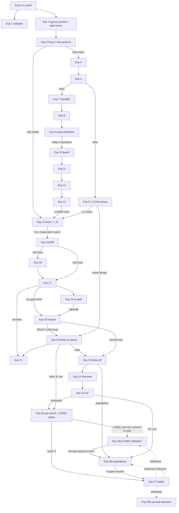

# Audit: every experiment, Exp 0 → Exp 27

Written 2026-11-28 (Phase 1). **Nothing was rerun.** Sources: `NIGHTLY_LOG.md` (all of it), `README.md`, `ARCHITECTURE.md` §13–16, `figures/exp*/tables*.md`, the earlier methods audit (`/workspace/agentworld-methods-audit/audit.md`, 2026-11-06) and its cross-model review (`hf_spaces_comparison.md`, `reviews_manifest.md`), and the code under `mvp/` at commit `2ad06fd`. The framework (levels L0–L4, rungs R0–R7) is in [`EPISTEMOLOGY.md`](EPISTEMOLOGY.md).

**Numbering.** The repo has no "Exp 0/1/2" labels. Here **Exp 0 = v1** (`sim.py`, the MVP world), **Exp 1 = v2 RQ1** (criticality) and **Exp 2 = v2 RQ2/RQ3** (agency proxies and dark rooms, `sim2.py`/`exp2.py`). Exp 3 onward use the repo's own numbers. Some experiments are split into sub-rows (a/b/c) where one row would have to give two different verdicts.

**Verdicts.**
- **STANDS**: the claim as stated follows from its evidence at the scope stated.
- **WEAKENED**: partly supported, but the scope or wording overreaches, or a confound is unresolved.
- **WITHDRAWN**: the claim is wrong or rests on an artifact.
- **UNINFORMATIVE**: the test could not have detected the thing claimed, so the result (usually a null) carries no evidence either way.

**Validated?** means validated on known positive and negative controls in the same world and regime, as defined in EPISTEMOLOGY §2 R1.

## Verdict counts (34 rows over Exp 0–27)

| STANDS | WEAKENED | WITHDRAWN | UNINFORMATIVE |
|---|---|---|---|
| 12 | 8 | 5 | 9 |

Every one of the 12 STANDS rows is descriptive, a selection/competition result, an engineering result, or a methodological result. **None is a positive agency claim about an evolved population, and none is an absence claim that meets the bar in EPISTEMOLOGY §4.** The only L1/L2 positive (Exp 20) is a hand-implanted rule.

## Code inspection done for this audit (assay arms and controls)

| arm / control | file:line | timing / convention | finding |
|---|---|---|---|
| Exp 3–5 open-loop / frozen-input replay | `exp3_perturb.py:111–128` | `x_ref = xprev` from the reference sim (the input used at step t), host recursion checked against the sim (`match_err`) | no timing bug. The *comparison* is structurally biased (see Exp 3b). |
| Exp 6/14 OPEN clamp | `exp6_regulate.py:81`, `exp14_perturb.py:178` | replays `act` recorded at step t at step t; `clamp0 == ref` | aligned (clamp0 exact while the reference lives); death-zeroed actions handled by a reference-survival filter (selection on survival) |
| Exp 6/14 "sensor-blind" | `exp6_regulate.py:82`, `exp14_perturb.py:178` | `e_off = dE` (constant offset = amount removed) | no lead. It is **offset-blind, not frozen**: the sensor still tracks eating and costs. Fine as a "deficit-blind" arm. |
| Exp 19 SHAM sense | `exp19_run.py:56–60` | `e_off = E[src] − E`, src a random permutation over live agents, pre-step E | no lead. A permutation can map an agent to itself (≈ 1/500 per step; negligible). Rep–E correlation uses pre-step E with the action from the same step (correct). |
| Exp 16–18 aware rule | `exp16_compete.py:23`, `exp17_run.py:52`, `exp18_run.py:28` | `c["E"] > thr`, pre-step | correct |
| **Exp 20/21 FROZEN** | `exp20_run.py:61`, `exp21_run.py:47` | `eref[t] = base E (t=0) / ref["E"][t−1]` = reference **pre-step** E | **correct**; Exp 21 also tests frozen0 (`tests/test_exp21.py:17`) |
| **Exp 22/23/24 FROZEN** | `exp22_run.py:55`, `exp24_run.py:79` (Exp 23 reuses Exp 22) | same one-step shift = pre-step | **correct. No lead.** (No frozen0 test, though.) |
| Exp 24 GC thrust map | `sim13.py:340–341`, `exp24_run.py:45` | fit on `xprev` (input at t) vs `act` (action at t); applied with the current step's x | aligned |
| **Exp 25 assay (post hoc K = 200) / Exp 26 COND FROZEN** | `exp25_assay.py:47`, `exp26_cond.py:49` | `e_ref = ref["E"]` at index t = reference **post-step** E fed at step t | **one-step lead (confirmed).** No frozen0 test existed. |
| **Exp 26 populations FROZEN** | `exp26_pop.py:71` | pre-step shift | **correct. No lead.** |
| Exp 27 FROZEN | `exp27_run.py:89, 126` | replays the controller input `u` that the reference actually used at step t | correct by construction (sense-level replay); **no frozen0 identity test for feedback controllers** (`tests/test_exp27.py` checks FROZEN == CL for P0 and FROZEN ≠ CL for STEP only) |
| Exp 27 ES training | `exp27_run.py:149–155` | trains on forks seed gen%9 and (gen+4)%9, keys 90000+ | **trained on the same 9 forks it is tested on** (different keys). That is mild leakage. It does not affect the within-ES ablation U, but it does make ES-vs-others comparisons optimistic for ES. |

Read-only data check (no simulation): on the Exp 20 t = 1500 forks, among eligible targets (alive, E ≥ 0.3), **70.5%** have E0 ∈ [0.4, 0.8), so a 50% drop takes them across STEP's θ = 0.40. **27.5%** are already below θ (STEP eats 1 in both ref and drop, so there is no action difference at step 0), and 2.0% stay above. So about 30% dilution of STEP's response at the drop step. That is real, but not the main reason STEP goes undetected.

## The table

| # | claim as stated | operational test | validated on controls? | power / sensitivity | bugs / leakage found | multiplicity / post hoc | verdict | fix requires |
|---|---|---|---|---|---|---|---|---|
| **0** (v1) | MVP world and visualisations (no scientific claim) | runs, smoke test, figures | n/a | n/a | none found | none | **STANDS** | nothing (engineering) |
| **1** (v2 RQ1) | "No criticality. Energy cost drives brains into order (median λ_max −0.16 → −0.70)." | conditional Lyapunov exponent (Benettin via `jax.jvp`), ρ(W_hh), σ²; controls shuffled / no_mut / no_cost; gate = beat every control | **partial**: standard estimator, not checked on planted near-critical networks in this setting | n = 3 per cell (df 2); 48 runs pooled per variant; a large effect | λ depends on the input distribution, and cost scales with output magnitude, so "order" is partly mechanical tanh saturation (repo §14) | 16 cells × several metrics, uncorrected | **STANDS** (narrow: "selection under energy cost produces ordered brains"). "No criticality" in general is a null in a world where nothing rewards criticality. | if the criticality question is kept: estimator ladder on planted σ² networks, plus a task where near-critical dynamics pay (pay-check first) |
| **2a** (v2 RQ2) | "Agency metrics beat no control in 0/16 cells." | heritability r, Simpson takeover, Krakauer-style individuality (Gaussian MI on PCA₄), empowerment proxy I(A;X′\|X) | **N**: no known agent or device was ever scored | n = 3, ~100–200 agent pairs per estimate; MDE unknown | estimator bias at small n (repo §14) | 16 cells × 4 metrics × 3 controls | **UNINFORMATIVE** | score known controllers (Exp 27 ladder, implant, blind) with each proxy first; else retire the proxies |
| **2b** (v2 RQ3) | "Dark rooms appear only when depletion or cost is removed; walls cut surprisal by ~4 nats but aren't selected for." | regime classifier (residence ≥ 100, speed < 0.2 v_term, analytic quiet), observer-side NLMS surprisal | **N** | n = 3; surprisal gate passes 1/16 cells | surprisal is the **observer's** linear model, not the agent's (§1.5 of EPISTEMOLOGY); crowding at the slot cap in static_env / no_cost | post hoc threshold choice later swept (Exp 8) | **WEAKENED** (descriptive counts stand; the "surprise drive" reading has no basis because agents never had a model) | if kept: planted dark-roomers and self-builders as positives; surprisal under a model the agent actually uses |
| **3a** | "Exact Price decomposition shows selection dominating (turnover, not individuals)." | exact Price identity, residual ≤ 6e-16 | n/a (an identity) | n = 3 | none; bitwise reruns of the saved runs | trait definitions (a)/(b) both reported | **STANDS** (as accounting; the identity holds by construction, so the residual is not evidence) | none, but power to detect a given selection coefficient has never been measured (planted-trait test, REBUILD step 6) |
| **3b** | "Closed loop amplifies kicks (closed − open log r(50) ≈ +13 to +16) … population sorting, not individual regulation." | hidden-state distance after a kick: closed loop vs open-loop replay of reference inputs vs frozen input | **N** | n = 3 | **structural bias**: open loop holds inputs fixed, so it is a contracting map; closed loop lets any action change of the kicked agent feed back into its inputs. Any behaving brain "amplifies". | none | **UNINFORMATIVE** about regulation | retire the hidden-state metric as an agency test, or validate it on a constructed regulator of hidden state (REBUILD step 5) |
| **4** | "Paying for regulation (pe_sense, lam_cost) did not produce regulation." | Exp 3 kick protocol + Price, 7 variants | **N** | n = 3 | as 3b; lam_cost "rarely triggers" because brains are already ordered, so no pay-check | 7 variants × several contrasts | **UNINFORMATIVE** | pay-check before evolving; regulation metric on a regulated variable, validated |
| **5** | "Charging for prediction error in a switching world: still passive; no closed loop beats replay." | Exp 3 kicks + Price, 7 variants | **N** | n = 3 | as 3b (PE cost did lower PE MSE 0.74 → 0.61: descriptive, stands) | 7 variants, many contrasts | **UNINFORMATIVE** | as 4 |
| **6** | "Passive and closed-loop energy recovery are indistinguishable or passive wins" (A −0.276 [−0.430, −0.121]; B +0.060 [−1.299, +1.419]) | 50% E drop; r = 1 − late deficit / removed; CL vs OPEN clamp vs offset-blind sensor | **N** | n = 3; B CI width ≈ 2.7 r-units vs plausible effects ≲ 0.3 | reproduction halving dominates the metric (methods audit §1); E-proportional share/theft give passive restoring force (§2); reference-survival filter conditions on survival (§5); rule tightened mid-run (§6) | 7 variants; rule changed after peeking | **UNINFORMATIVE** | validated metric (REBUILD 1–2), births controlled, n from a power analysis |
| **7** | "Self-built dark rooms do not appear under pe_cost with depletion on." | classifier at 100/0.2, scalar `own` proxy | **N** | 0–9 residents per world, so P(self-built \| resident & quiet) is essentially unestimated (methods audit §3) | unconditional denominator; overdetermination in the self-built definition (§4) | 7 variants | **UNINFORMATIVE** | planted self-builder positive control; conditional estimand; enough residents |
| **8** | "Self-built null not threshold-fragile; CF_own reclass other→self in sw_no_cost +0.05." | 4×4 threshold sweep; CF replay deleting the scalar `own` proxy | **N** | low (few dark targets) | proxy attribution (fixed in Exp 9) | 16 grid cells × 7 variants; reclass is one contrast | **WEAKENED**: the sweep stands descriptively; the reclass signal largely vanishes with an equal-mass control (Exp 9: true−ctrl +0.033 [−0.096, +0.163]) | superseded by Exp 9 |
| **9** | "Exact attribution: self-built CI > 0 in no variant; true CF ≯ equal-mass control." | exact per-agent lifetime deposit maps (`Adep`), bit-for-bit vs sim5; CF delete-own vs equal-mass far control | **partial**: instrument exactness verified (accounting residual 7e-7, bitwise); no planted positive | pe_cost arms only 2–14 dark targets across 3 seeds, so CF power is very low; sw_no_cost has a 9/120 tail | none | several variants | **STANDS** (narrow, descriptive: exact self-built fraction ≈ 0 at default thresholds). The CF null is underpowered. | planted builder to calibrate CF power before any CF null is read |
| **10** | "Privately valuable walls (share-based guard) change nothing measurable." | Price on build, self-built, CF | **N** | n = 3; **the lever never reached a paying dose** (claim ≈ 0.05; private return < build cost, per the authors' own estimate) | none | ~6 arms | **UNINFORMATIVE** (dose too small, as the log itself concluded) | none; superseded by Exp 11 |
| **11** | "Private return clearly beats build cost, but building is not measurably selected or increased; self-built stays 0." | exact one-step private return (`premstep`), Price ΣS(build), dose slope | return measure exact (counterfactual within step) | n = 3; build CIs ± 0.3 | private return is partly transfer from neighbours (log ¶5) | ~6 contrasts × several measures; the mg2 − shuffled lead is 1 of many | **WEAKENED**: the return > cost part stands; "not selected" is an n = 3 null | — (tested further in 12/13) |
| **12** | "Pre-registered: building positively selected when heredity is intact, ΣS(build) mg2 − shuffled +0.146 [+0.027, +0.264], n = 9." | Price ΣS, t ≥ 1000, paired by seed | n/a | n = 9, but **3 of the 9 seeds are the discovery seeds**; the 6 new seeds alone give +0.167 [−0.032, +0.366] | analysis glob bug, caught before commit | primary pre-registered, but pooled with discovery data; secondaries labelled | **WEAKENED** (not an independent confirmation) | confirm on fresh seeds only (REBUILD step 6) |
| **13** | "Pre-registered: mean build mg2 − shuffled over t ≥ 5000 does not hold (+0.011 [−0.045, +0.068]); transient divergence 2–6k." | 10k-step runs, n = 9, pre-registered contrast | n/a | CI half-width ≈ 0.057; MDE not stated | resume bit-exact; none | 15 post hoc windows (labelled) | **STANDS** (as a pre-registered null of that size). The log's "closes the private-wall line in this world" overreaches (one parameter regime). | none for the claim; scope wording |
| **14** | "Pre-registered primary does not hold: closed − open −19.25 [−20.85, −17.66] … nothing beats passive at 4× the horizon." | Exp 3 kicks + Exp 6 energy drop on t = 5000/10000 forks, n = 9 | **N** | kick metric bounded by float32 (log r ≈ −21); energy-drop B CI ± 0.22 r-units, sensitivity unknown | as 3b and 6 (offset-blind arm, no lead) | 20 kick cells + 8 drop contrasts | **UNINFORMATIVE** | as 3b and 6 |
| **15** (+15b, prior) | (a) satiety mechanic gives no gradient, so not evolved; (b) "selection on energy-sensitivity matches shuffled control, no agency claim"; prior: "no sign the energy sense is wired to eating" | (a) hand-policy pay-check; (b) Price ΣS of exact ∂eat/∂E, shuffled heredity; prior: es vs row-8-shuffled weights | (a) n/a (a pay-check); (b) **N** (no planted selected trait) | (a) 3 seeds; (b) p = 0.049, borderline | none | (b) primary pre-registered | **STANDS** for (a) and (b). The prior's gloss is **definition drift**: \|es\| ≈ 0.047 = the weight-shuffled null, which means unselected, not absent. | planted-trait power check (step 6); L0 test with a random-brain null (step 1) |
| **16** | "Brain-gated reproduction fails its pre-registered pay-check; aware lineages lose in mixed competition (9/9 negative)." | hand-policy pay-check (monoculture), post hoc lineage competition | n/a (pay-check of known policies) | 3 seeds | none; gate wording changed before data (documented) | competition post hoc (labelled) | **STANDS** | none |
| **17** | "Gate passes; evolution finds blind low-rate reproduction; primary B fails (+0.107 [−0.497, +0.710]); rep–E correlation slightly negative in both arms." | lineage-competition gate; evolution n = 9; Exp 6 r on stored E; rep–E correlation | gate: n/a; B: **N** | B: \|r\| > 1, so the metric is dominated by single 0.79-E births (authors' caveat) | **rep–E correlation used post-step E**, biased negative (found in Exp 19) | gate vs always is near-trivial; vs matched blind n = 3 | **WEAKENED**: gate and evolution description stand; primary B **uninformative**; the "slightly negative" correlation is **withdrawn** | births-aware validated metric; pre-step correlation (already done in Exp 19) |
| **18** | "Pre-registered re-gate passes: aware (THR 0.8) beats blind(p*) 9/9, +0.149 [+0.056, +0.241]." | mixed competition vs Bernoulli blind at a swept rate | n/a | 9 seeds; the p* sweep saturated (uninformative argmax) | **design gap**: the blind comparator family is fixed-rate Bernoulli only. The obvious best blind strategy, a **refractory timer** ("wait k steps after a birth", energy-blind but exploits E regrowth), was never tested. The low-rate blind solution Exp 17 evolved may be timer-like. | post hoc all-p check, 2/63 cells negative | **WEAKENED** ("beats the best available blind rate" is "beats Bernoulli blinds") | add blind-timer comparators (fair search over blind *policies*, not rates) |
| **19** | "Implanted energy-conditioned rep rule goes to fixation vs sham (D +0.995 [+0.993, +0.998]); Exp 17's null was a discovery failure." | implant in 50% of Exp 17 forks; TRUE vs SHAM (random other agent's E); Price on the marker | n/a (selection test) | huge effect | SHAM not rate-matched (≈ 1.3× rate); sham permutation can self-map (negligible) | pre-registered | **STANDS** (selection result; L4-relevant at lineage level). "Discovery failure" is an interpretation; the implant's large gain and dedicated unit may simply be unreachable by small mutations, which is consistent with it. | none for the claim |
| **20** | "Closed loop beats OPEN (+0.404) and FROZEN (+0.367) on lineage energy … decision rule met for reproduction-timing recovery in an implanted, hand-designed rule." | births-on drop assay, 40 implant-marker targets, lineage-energy r | effectively **this is a single positive control** (one constructed system, no ladder, no blind FPR in this world) | n = 9; large effect | **FROZEN timing verified correct** (`exp20_run.py:61`); clamp0 exact; 40 simultaneous targets interact | pre-registered; strata post hoc | **STANDS** as "the births-on assay detects a strong, hand-implanted reproduction-timing feedback". The **agency wording is withdrawn**: a device met the rule, so the rule is not an agency criterion. | relabel; use as one rung of a births-on calibration ladder |
| **21** | "Exp 20's CL advantage is specific to the energy-aware (implanted) brains (ΔA +0.371, ΔB +0.378)." | same assay on no-implant forks; ΔA/ΔB paired by seed across experiments | **N** | n = 9 | **confound**: populations differ in age and E distribution (Exp 20 targets E0 lower by 0.346); within E0 ≤ 0.8, ΔB CI includes 0; target selection differs (marker vs any). Exp 22's age-matched SHAM still differs in E0 (−0.266). | pre-registered | **WEAKENED** | E-matched (not just age-matched) control population; same target rule |
| **22** | "Births-off: A +0.237 but B +0.004 → FAIL: no active foraging recovery; same in ctrl and SHAM." | own-E r, 40 targets, CL vs OPEN vs FROZEN | **N** (r_E later missed a known controller, Exp 25) | B CI ± 0.13 r-units; MDE unknown; **energy feedback has little to buy in this world** (Exp 25 null at haz = 0) | FROZEN verified pre-step (`exp22_run.py:55`); no frozen0 test; OPEN A non-specific (stale replay harm) | 3 populations | **UNINFORMATIVE** for "no foraging recovery"; A > 0 stands but is non-specific | validated L0/L2 metrics (REBUILD 1–2), in a world where feedback pays, with TOST |
| **23** | "Pre-registered verdict: foraging-relevant correction present: move (A_move +0.218 [+0.012, +0.424]) — weak, not trusted." | partial-OPEN per channel | **N** | lower bound +0.012; two looks uncorrected | none in the arms (clamp0 exact); the effect is the stale-replay artifact (Exp 24) | 3 channels × 3 pops | **WITHDRAWN** | — |
| **24** | "CL ≈ state-matched energy-blind GC (A_GC −0.104 [−0.358, +0.151]); Exp 23's A_move was stale replay; no closed-loop recovery beyond a state-matched passive control." | GC thrust map fitted on own ref run, baseline GC0 | **N** | r_E, 40 targets; CI admits +0.15 | **baseline asymmetry**: r*_GC vs GC0 (separate chaotic trajectory) vs CL vs ref | 3 pops, GC and GCX | **WEAKENED**: the stale-replay explanation is supported (r*_GC − r_MOVE +0.322 [+0.072, +0.572]); "no recovery beyond passive" is uninformative | — (superseded by the rebuild) |
| **25a** | "Pre-registered pay-check PASSES: COND beats the best of 11 blind efforts, D* +0.125 [+0.086, +0.165]; loses at haz = 0 (−0.029)." | within-world parity design, CRN, fair blind search on the same seeds | n/a (pay-check of known policies); the haz = 0 null control behaves as predicted | 9 seeds, 9/9 | θ and haz set from the same forks (stated); D_sham inflated by a harmful sham | pre-registered | **STANDS** (the world can reward energy feedback under a starvation–predation trade-off) | test against blind *policies* with memory (timers) as well as constant efforts |
| **25b** | "Own-E assay does NOT detect the known controller; post hoc survival read-out at K = 200 does (A_surv +0.041, B_surv +0.087)." | drop assay on COND | this *was* the validation attempt | K = 40 underpowered; K = 200 post hoc | **FROZEN post-step lead** (`exp25_assay.py:47`) inflates B; A non-specific | post hoc | **WITHDRAWN** (the "does detect" half); the own-E miss stands as a failure of r_E | — |
| **26a** | "COND replication PASSES (fresh targets and key): A_surv +0.031, B_surv +0.072 [+0.041, +0.103]." | pre-registered replication | — | D (cost of drop) +0.024 [−0.008, +0.056] | **FROZEN lead** (`exp26_cond.py:49`); and **its own pre-registered informativeness rule** ("if D's CI includes 0 the metric is uninformative there") **was not applied to COND** | pre-registered | **WITHDRAWN** (corrected B +0.019 [−0.013, +0.052], Exp 27) | — |
| **26b** | "TRUE/ctrl/SHAM B_surv ≈ 0: the three nights of nulls were not a metric artifact; CIs exclude effects a third the size of COND's." | survival assay, K = 200, three populations | rested on 26a | B upper bounds +0.023 / +0.026 / +0.018, **above** STEP's +0.020 in Exp 27 | **FROZEN timing correct here** (`exp26_pop.py:71`). The B estimates are valid data. Only the inference fails. | 3 pops, uncorrected | **WITHDRAWN** (the inference); the data are reusable once calibrated in a no-predation, sighted-brain ladder | calibration ladder in the populations' own world (REBUILD 2) |
| **27a** | "Drop assay is specific but insensitive: FPR 0/30; STEP 1/5, ES 0/5 (ES uses energy: U +0.036 [+0.030, +0.043]); g_min = NONE." | pre-registered ladder P(g), STEP, ES, blind controls, shams; R = 5 × 9 seeds | **this is the validation** | pooled B_surv P1 +0.010 [+0.005, +0.015] has lower bound > 0, so the per-replicate rule throws away power; sensitivity is capped by the drop's cost D ≈ 0.035–0.062; B is non-monotone in g (value, not presence) | ES trained on the test forks (keys disjoint); no frozen0 test; **"FPR 0/30" is generous**: 4/6 blind controls have B ≡ 0 by construction, and the two shams are *harmful* (B −0.021, −0.033), not null; **A-only false positives 5/30** | pre-registered; post hoc diagnostics labelled | **STANDS** with those qualifications | define detection on pooled seeds; neutral shams; frozen0 test; held-out forks for ES; an action-level presence metric (REBUILD 1) |
| **27b** | "Post hoc: Exp 26's COND B_surv +0.072 was a FROZEN post-step-lead artifact (+0.019 with pre-step input), reproduced to the digit." | rerun with Exp 26's targets, keys, hazard draws and both conventions | — | — | verified in code for this audit (`exp25_assay.py:47`, `exp26_cond.py:49`) | post hoc, R = 1 | **STANDS** | add frozen0 identity tests everywhere (REBUILD 0) |
| **27c** | "Exp 22–26 FROZEN arms for the evolved brains use the same lead (e_off = ref post-step E − E), so their B_surv is biased toward detecting feedback." (NIGHTLY_LOG Exp 27 entry) | — | — | — | **false.** Exp 20–24 and `exp26_pop.py` shift the reference energy by one step (`np.concatenate([base E, ref["E"][:-1]])`), which gives the **pre-step** value (`exp20_run.py:61`, `exp21_run.py:47`, `exp22_run.py:55`, `exp24_run.py:79`, `exp26_pop.py:71`). Only Exp 25's assay and Exp 26's COND script have the lead. | — | **WITHDRAWN** | correction appended to NIGHTLY_LOG (2026-11-28) |

## Bugs and problems newly found in this audit

| id | what | where | effect |
|---|---|---|---|
| **B1** | **False bug claim in the log**: the Exp 27 entry says the Exp 22–26 evolved-population FROZEN arms carry the post-step lead. They do not. | `NIGHTLY_LOG.md` Exp 27 POST HOC paragraph vs `exp22_run.py:55`, `exp24_run.py:79`, `exp26_pop.py:71` | no numbers change. The Exp 22–26 B estimates are unbiased by timing. Their nulls are uninformative for *sensitivity* reasons, not because of a lead. |
| **B2** | **Pre-registered rule not applied**: Exp 26 said the metric is "uninformative" where the cost of the drop D has a CI including 0; COND had D +0.024 [−0.008, +0.056] and was still reported as PASS. | `NIGHTLY_LOG.md` Exp 26 pre-reg and results | by its own rule, COND should have been reported uninformative even before the lead was found |
| **B3** | **No frozen0 identity test** in Exp 22–27 (only Exp 21 has one) | `tests/` | how the Exp 25/26 lead survived; Exp 22–27 FROZEN timing is correct by inspection only |
| **B4** | **Specificity overstated**: FPR 0/30 counts four controls whose B is identically 0 by construction; only 10 replicates could produce a false B, and those two shams are harmful (B < 0), not neutral; A alone has 5/30 false positives | `figures/exp27/tables27.md` | "high specificity" holds for the joint rule only, and largely by construction |
| **B5** | **Missing blind-policy class**: blind refractory timers never tested as comparators in Exp 17/18 (or Exp 25: blind constant efforts only) | `exp18_run.py`, `exp25_run.py` | "aware beats the best blind" is "beats the best Bernoulli/constant blind" |
| **B6** | **Structural bias of closed- vs open-loop hidden-state distance** | `exp3_perturb.py` design (Exp 3, 4, 5, 14) | four experiments' regulation verdicts uninformative |
| **B7** | ES trained on the 9 test forks | `exp27_run.py:149–155` | mild optimism in ES-vs-other comparisons; ablation U unaffected |
| B8 | (known, restated) post-step E in the Exp 17 rep–E correlation; death-zeroed replay (Exp 6/20, handled); Exp 12 discovery-seed pooling | — | as in the table |

## Dependency graph

An arrow `X → Y` means "Y's claim, design, population or metric rests on X". If X is WITHDRAWN or UNINFORMATIVE, every Y that uses X for that purpose inherits that status for that part, unless Y independently re-established it.

### How the invalidations propagate

1. **Kick metric uninformative (B6)** → Exp 3b, 4, 5, 14 (kicks) uninformative → the program-level sentence "within a lifetime no individual preserves its regime through its own behaviour; the loop amplifies" (ARCHITECTURE §16.3) is **uninformative** about regulation. The Price half ("selection dominates") stands.
2. **r_E metric unvalidated, and it missed COND (Exp 25)** → Exp 6, 14 (energy drop), 17 (B), 22, 23, 24 nulls are **uninformative**. → Exp 15's motivating premise ("evolved brains do not use the energy sense", from Exp 6/14 B ≈ 0) is **unsupported**. Exp 15–19 still stand on their own because they used pay-checks and selection tests, not r_E.
3. **Exp 26a withdrawn (lead + B2)** → Exp 26b's "nulls confirmed" **withdrawn** → no absence claim about energy use by evolved brains exists anywhere in the repo.
4. **Exp 20 relabelled (device met the rule)** → the decision rule "active beats passive ⇒ agency" is **retired** → any future pass must be read at a named level (EPISTEMOLOGY §1.1).
5. **Exp 21 weakened (E-distribution confound)** → "the CL advantage is specific to energy-aware brains" is provisional.
6. **Single fork family**: Exp 19 → 20 → 21–27 all descend from the 9 Exp 17 `sw_pays` lineages. Any population-level claim in Exp 19–27 is a claim about those 9 lineages until replicated on fresh evolutionary runs (REBUILD step 3).
7. **27c withdrawn** → corrects a propagation error: Exp 22–26 population B values are **not** biased by timing, so they need recalibration, not recomputation.
8. **Dark-room / niche line (Exp 7–13)**: no positive control anywhere, so every self-built null is uninformative about *capacity*. Exp 9's exact counts and Exp 13's pre-registered build null stand as descriptions. Separately: dark-rooming ≠ agency (stated throughout the log, and correct).
